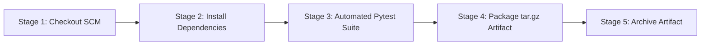

# Customer Service Complaint Management System

A production-grade DevOps project implementing a lightweight Python Flask REST API for managing customer complaints, integrated with Continuous Integration (CI) and Continuous Deployment / Configuration Management (CD) pipelines.

---

## 1. Project Introduction

The **Customer Service Complaint Management System** is built for college DevOps coursework to demonstrate modern software delivery lifecycles. It connects code development with automated testing, continuous integration, configuration management, containerization, and container orchestration into a unified DevOps pipeline.

The project is structured into two core components using the exact same application:
- **Component 1**: CI/CD Pipeline using Git branching, automated Pytest testing, Jenkins Declarative Pipeline, and artifact packaging.
- **Component 2**: Configuration Management using Ansible (roles, handlers, variables, systemd service) and container orchestration using Docker and Kubernetes (Minikube with Deployment, Service, Replicas, Scaling, and Liveness/Readiness probes).

---

## 2. Problem Statement

Organizations receive high volumes of customer service feedback and complaints. Without a streamlined, automated release pipeline, software updates are slow, error-prone, and inconsistent across environments.

This project addresses:
1. **Manual deployment errors**: Solved by automating builds, unit testing, and packaging via Jenkins.
2. **Configuration drift**: Solved by using Ansible playbooks and declarative roles to configure runtime dependencies and systemd services reproducibly.
3. **Environment inconsistency & downtime**: Solved by containerizing the application with Docker and orchestrating self-healing, horizontally scalable workloads via Kubernetes.

---

## 3. Objectives

- Develop a minimal, zero-frontend, zero-database REST API using Python 3 and Flask.
- Implement in-memory data structures for fast, lightweight complaint processing.
- Build an automated test suite using Pytest covering health checks, creation, retrieval, and validation failures.
- Automate CI workflows via Jenkinsfile to build, test, package (`tar.gz`), and archive release artifacts upon Git events.
- Automate infrastructure and application deployment using Ansible roles, tasks, handlers, variables, and systemd units.
- Containerize the application with an optimized multi-layer Dockerfile.
- Orchestrate deployment using Kubernetes with 3 initial replicas, a NodePort service, horizontal pod scaling (3 to 5 and back to 3), and HTTP health probes.

---

## 4. Application Functionality

The application provides three REST endpoints:
1. `GET /health`: Health verification endpoint returning system status and service version (used by Kubernetes liveness and readiness probes).
2. `POST /complaints`: Accepts customer complaints in JSON format, validates mandatory fields and email format, generates a sequential unique ID, and assigns initial status `Open`.
3. `GET /complaints`: Retrieves all active customer complaints stored in memory.

---

## 5. Technology Stack

| Domain | Technology / Tool | Version |
| :--- | :--- | :--- |
| **Backend Framework** | Python / Flask | Python 3.11+ / Flask 3.1+ |
| **Automated Testing** | Pytest | 9.x+ |
| **WSGI Server** | Gunicorn / Werkzeug | 23.x+ |
| **Version Control** | Git & GitHub | Git 2.x |
| **Continuous Integration** | Jenkins (Declarative Pipeline) | 2.x+ |
| **Configuration Management** | Ansible | 2.15+ |
| **Containerization** | Docker | 20.x+ / 24.x+ |
| **Container Orchestration** | Kubernetes / Minikube | v1.28+ |

---

## 6. Project Structure

```
Devops-01/
├── app.py                                  # Flask REST API implementation
├── requirements.txt                        # Application and test dependencies
├── run.py                                  # Application entrypoint server
├── tests/
│   └── test_app.py                         # Pytest test suite (>3 tests, full endpoint coverage)
├── Jenkinsfile                             # Jenkins CI Declarative Pipeline definition
├── Dockerfile                              # Container image specification
├── .gitignore                              # Git exclusion rules
├── README.md                               # Comprehensive documentation
├── ansible/
│   ├── ansible.cfg                         # Ansible runtime configuration
│   ├── inventory                           # Target inventory hosts definition
│   ├── playbook.yml                        # Main deployment playbook invoking customer_service role
│   └── roles/
│       └── customer_service/
│           ├── defaults/
│           │   └── main.yml                # Configurable default variables (ports, paths, users)
│           ├── handlers/
│           │   └── main.yml                # Notification handlers (systemd daemon reload & restart)
│           ├── tasks/
│           │   └── main.yml                # Automated deployment tasks and venv configuration
│           └── templates/
│               └── customer-service.service.j2 # Jinja2 template for Linux systemd unit
└── kubernetes/
    ├── deployment.yaml                     # K8s Deployment (3 replicas, resources, liveness/readiness probes)
    └── service.yaml                        # K8s NodePort Service exposing port 5000 on nodePort 30500
```

---

## 7. Installation Instructions (Local Development)

### Prerequisites
- Python 3.9 or higher installed
- pip package manager

### Steps
1. Clone the repository:
   ```bash
   git clone https://github.com/ManjuCI069/Devops-01.git
   cd Devops-01
   ```

2. Create and activate a virtual environment:
   - **Linux / macOS**:
     ```bash
     python3 -m venv venv
     source venv/bin/activate
     ```
   - **Windows (PowerShell)**:
     ```powershell
     python -m venv venv
     .\venv\Scripts\Activate.ps1
     ```

3. Install dependencies:
   ```bash
   pip install --upgrade pip
   pip install -r requirements.txt
   ```

4. Run the application:
   ```bash
   python run.py
   ```
   The API will be available at `http://localhost:5000`.

5. Run automated tests:
   ```bash
   pytest tests/test_app.py -v
   ```

---

## 8. API Endpoint Documentation & Examples

### 1. Health Check
- **Endpoint**: `GET /health`
- **Description**: Returns the health status and metadata of the application.
- **Example Response (200 OK)**:
  ```json
  {
    "service": "customer-service-complaint-management-system",
    "status": "healthy",
    "version": "1.0.0"
  }
  ```

### 2. Submit a Complaint
- **Endpoint**: `POST /complaints`
- **Headers**: `Content-Type: application/json`
- **Request Body**:
  ```json
  {
    "customer_name": "Rahul",
    "email": "rahul@example.com",
    "subject": "Payment issue",
    "description": "Payment was deducted but order was not confirmed."
  }
  ```
- **Example Response (201 Created)**:
  ```json
  {
    "message": "Complaint submitted successfully",
    "complaint": {
      "id": 1,
      "customer_name": "Rahul",
      "email": "rahul@example.com",
      "subject": "Payment issue",
      "description": "Payment was deducted but order was not confirmed.",
      "status": "Open",
      "created_at": "2026-11-18T15:16:43.650528+00:00"
    }
  }
  ```

### 3. Retrieve All Complaints
- **Endpoint**: `GET /complaints`
- **Example Response (200 OK)**:
  ```json
  {
    "total": 1,
    "complaints": [
      {
        "id": 1,
        "customer_name": "Rahul",
        "email": "rahul@example.com",
        "subject": "Payment issue",
        "description": "Payment was deducted but order was not confirmed.",
        "status": "Open",
        "created_at": "2026-11-18T15:16:43.650528+00:00"
      }
    ]
  }
  ```

---

## 9. Example cURL Commands

### Health Check:
```bash
curl -X GET http://localhost:5000/health
```

### Submit Complaint:
```bash
curl -X POST http://localhost:5000/complaints \
  -H "Content-Type: application/json" \
  -d '{
    "customer_name": "Rahul",
    "email": "rahul@example.com",
    "subject": "Payment issue",
    "description": "Payment was deducted but order was not confirmed."
  }'
```

### Retrieve All Complaints:
```bash
curl -X GET http://localhost:5000/complaints
```

### Validation Error Test (Missing Fields):
```bash
curl -X POST http://localhost:5000/complaints \
  -H "Content-Type: application/json" \
  -d '{
    "customer_name": "Rahul"
  }'
```

---

## 10. Git Branching and Merging Procedure

The assignment requires standard Git branch-based development:

1. **Check repository status**:
   ```bash
   git status
   ```

2. **Create and switch to the feature branch**:
   ```bash
   git checkout -b feature/complaint-api
   ```

3. **Stage all files and commit to the feature branch**:
   ```bash
   git add .
   git commit -m "feat: implement Customer Service Complaint Management API, tests, CI/CD, Ansible, Docker and K8s configs"
   ```

4. **Switch to main branch and merge**:
   ```bash
   git checkout main
   git merge --no-ff feature/complaint-api -m "merge: merge feature/complaint-api into main"
   ```

5. **Push both branches to remote repository**:
   ```bash
   git push origin main
   git push origin feature/complaint-api
   ```

---

## 11. Jenkins CI Pipeline (Component 1)

The `Jenkinsfile` specifies a 5-stage Declarative Pipeline:



### How to Configure the Jenkins Job:
1. Open Jenkins Web Dashboard (`http://localhost:8080`).
2. Click **New Item** > Enter `Customer-Service-CI` > Select **Pipeline** > Click **OK**.
3. Under **Build Triggers**, enable:
   - **GitHub hook trigger for GITScm polling** (triggers instantly on Git push).
   - **Poll SCM** with schedule `H/5 * * * *` (polls repository every 5 minutes as backup).
4. Under **Pipeline**:
   - **Definition**: Select *Pipeline script from SCM*.
   - **SCM**: Select *Git*.
   - **Repository URL**: `https://github.com/ManjuCI069/Devops-01.git`.
   - **Branch Specifier**: `*/main`.
   - **Script Path**: `Jenkinsfile`.
5. Click **Save** and click **Build Now**.

### Pipeline Stages Explained:
1. **Checkout SCM**: Clones the latest commit from `main`.
2. **Install Dependencies**: Creates an isolated virtual environment and installs `requirements.txt`.
3. **Automated Pytest Suite (CI Enhancement)**: Runs `pytest tests/test_app.py --junitxml=test-results/results.xml -v`. The `junit` post-action parses the XML report and generates test trend charts.
4. **Package Application**: Compresses application code into `dist/customer-service-${BUILD_NUMBER}.tar.gz` excluding temporary files and caches.
5. **Archive Artifacts**: Archives the `.tar.gz` artifact for deployment via Ansible.

---

## 12. Ansible Configuration Management (Component 2)

Ansible provisions and configures the target host idempotently using a structured role:

### Structure:
- `ansible/ansible.cfg`: Configures role paths, inventory, and host key checking.
- `ansible/inventory`: Defines deployment targets (`localhost` or remote hosts).
- `ansible/playbook.yml`: Top-level orchestration playbook applying the `customer_service` role.
- `roles/customer_service/defaults/main.yml`: Default configuration variables (port: 5000, directory: `/opt/customer-service`, user: `root`).
- `roles/customer_service/tasks/main.yml`:
  1. Installs OS packages (`python3`, `python3-pip`, `python3-venv`, `tar`).
  2. Creates `/opt/customer-service` directory.
  3. Copies application code (`app.py`, `run.py`, `requirements.txt`).
  4. Sets up Python virtual environment and installs dependencies.
  5. Renders systemd service file from Jinja2 template (`customer-service.service.j2`).
  6. Reloads systemd daemon and restarts service via handlers.
- `roles/customer_service/handlers/main.yml`: Handlers to reload systemd daemon and restart the service on configuration change.

### Running Ansible Playbook (on a Linux deployment host):
```bash
cd ansible
ansible-playbook playbook.yml
```

---

## 13. Docker Image Build and Execution

### Build Image:
```bash
docker build -t customer-service:1.0 .
```

### Run Container:
```bash
docker run -d --name customer-service-app -p 5000:5000 customer-service:1.0
```

### Verify Container Health:
```bash
curl http://localhost:5000/health
```

### View Container Logs & Stop:
```bash
docker logs -f customer-service-app
docker stop customer-service-app
docker rm customer-service-app
```

---

## 14. Kubernetes Deployment & Service

### Architecture
- **Replicas**: 3 pods running `customer-service:1.0`.
- **Service**: NodePort service exposing container port `5000` on external nodePort `30500`.
- **Health Probes**: Liveness probe checks `/health` every 10s (initial delay 15s). Readiness probe checks `/health` every 5s (initial delay 5s).

### Deployment Steps:
1. Start Minikube (if not already running):
   ```bash
   minikube start
   ```

2. Load the Docker image into Minikube:
   ```bash
   minikube image load customer-service:1.0
   ```

3. Deploy manifests:
   ```bash
   kubectl apply -f kubernetes/deployment.yaml
   kubectl apply -f kubernetes/service.yaml
   ```

4. Verify resources:
   ```bash
   kubectl get pods -l app=customer-service
   kubectl get deployments
   kubectl get services
   ```

5. Access application via Minikube Service URL:
   ```bash
   minikube service customer-service --url
   ```

---

## 15. Scaling Procedure (3 -> 5 -> 3 Replicas)

Demonstrating Kubernetes horizontal scalability:

1. **Check initial 3 replicas**:
   ```bash
   kubectl get pods -l app=customer-service
   ```

2. **Scale up from 3 to 5 replicas**:
   ```bash
   kubectl scale deployment customer-service --replicas=5
   kubectl get pods -l app=customer-service -w
   ```

3. **Verify 5 running replicas**:
   ```bash
   kubectl get deployment customer-service
   ```

4. **Scale down from 5 back to 3 replicas**:
   ```bash
   kubectl scale deployment customer-service --replicas=3
   kubectl get pods -l app=customer-service -w
   ```

---

## 16. Health Probe Implementation (Deployment Enhancement)

Liveness and readiness probes ensure high availability and self-healing:

```yaml
livenessProbe:
  httpGet:
    path: /health
    port: 5000
  initialDelaySeconds: 15
  periodSeconds: 10
  timeoutSeconds: 3
  failureThreshold: 3
readinessProbe:
  httpGet:
    path: /health
    port: 5000
  initialDelaySeconds: 5
  periodSeconds: 5
  timeoutSeconds: 2
  successThreshold: 1
  failureThreshold: 3
```

### Verification:
```bash
kubectl describe deployment customer-service
```
Under **Pod Template > Containers > customer-service**, inspect:
- `Liveness: http-get http://:5000/health delay=15s timeout=3s period=10s #success=1 #failure=3`
- `Readiness: http-get http://:5000/health delay=5s timeout=2s period=5s #success=1 #failure=3`

---

## 17. Application Limitations

> [!WARNING]
> **In-Memory Volatility**: The application intentionally uses an in-memory Python list data structure (`complaints = []`) without an external persistent database (e.g., PostgreSQL, SQLite, MySQL) as specified by the assignment requirements.
>
> Consequently, **all complaint data is temporary and will disappear when the application process, container, or pod restarts**.

---

## 18. Future Enhancements

1. **Persistent Database**: Integrate PostgreSQL or SQLite via SQLAlchemy for persistent data storage across restarts.
2. **Authentication & RBAC**: Add JWT token authentication and role-based access control (Admin vs Customer).
3. **Frontend Dashboard**: Build a React or Vue.js customer complaint portal.
4. **Monitoring & Observability**: Add Prometheus metrics endpoint (`/metrics`) and Grafana dashboards for request latency and error rate tracking.
5. **Ingress Controller**: Implement Kubernetes Ingress with TLS termination instead of NodePort for production routing.
